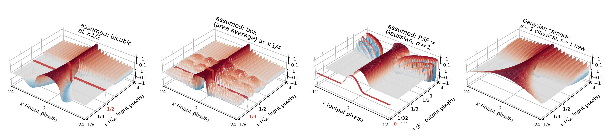

# ResizeRight Optics (RRO)

**Image resizing from a camera model, for NumPy and PyTorch.**

[Project page](https://assafshocher.github.io/image-scaling/) ·
[Paper](https://assafshocher.github.io/image-scaling/) ·
[Video](https://www.youtube.com/watch?v=rJA-o38VrLw) ·
[Experiments](experiments/README.md) · [BibTeX](#citation)

RRO extends [ResizeRight](https://github.com/assafshocher/ResizeRight) with the
camera-derived scaling operators from **A Unified Theory of Image Scaling:
Point Spread Functions, Discrete Kernels, and Scale-Spaces**.

Rather than stretching the same interpolation kernel at every scale, a camera's
point spread function determines a family of continuous scaling kernels:

```math
\widehat K_s(\omega)=\widehat K_0(\omega/s)\,\widehat K_0(\omega)^\dagger.
```



## Why use it?

1. **One model for downscaling and upscaling.** Specify the camera PSF or infer
   the family from a known resize kernel at a stated scale.
2. **Scale and output size stay separate.** RRO uses ResizeRight's centered
   grid, including when rounding means `out_size / in_size` differs from the
   requested scale. You can specify both.
3. **NumPy and PyTorch use the same API.** Arrays stay in their original
   framework and device. PyTorch supports differentiation through images and
   smooth camera parameters.
4. **Arbitrary tensor dimensions.** Resize selected axes with shared or
   different scales, using separable or genuinely nonseparable cameras.
5. **Several numerical implementations.** Finite spatial kernels for images,
   rational polyphase convolutions, and a periodic Fourier reference.

The ideal identities apply on the appropriate camera bands. Finite kernel
support, boundaries, rounding and inverse regularization affect numerical
consistency. The [validation report](VALIDATION.md) measures those effects.

## Installation

```bash
git clone https://github.com/assafshocher/ResizeRightOptics.git
cd ResizeRightOptics
pip install .                    # NumPy
pip install '.[torch]'            # optional PyTorch support
```

Python 3.10 or newer. The library requires NumPy; the paper experiments have
[separate dependencies](experiments/README.md).

## Usage

```python
import numpy as np
from resize_right_optics import resize, Gaussian

image = np.random.default_rng(0).random((96, 128, 3))  # HWC, floating point
camera = Gaussian(sigma=0.7)                        # PSF width in input pixels

small = resize(image, scale_factors=0.5, camera=camera)
large = resize(small, scale_factors=2, camera=camera)
```

Use the same interface for PyTorch tensors:

```python
import torch
from resize_right_optics import resize, Gaussian

image = torch.rand(1, 3, 96, 128, requires_grad=True)  # NCHW
small = resize(image, 0.5, camera=Gaussian(0.7))
small.square().mean().backward()
```

Pass both the intended scale and output dimensions when their ratio differs:

```python
small = resize(image, 0.5, out_shape=(48, 64), camera=Gaussian(0.7))

# Different scales on explicit axes:
image_np = np.random.default_rng(1).random((95, 127, 3))
result = resize(image_np, [0.6, 0.8], out_shape=[57, 102],
                dims=[0, 1], camera=Gaussian(0.7))
```

With no camera specified, `resize(image, 0.5)` uses a family inferred from
Keys cubic at scale 1/2. This is a cubic-derived camera model; it does not
certify a nonnegative physical PSF.

### Supply a PSF or an interpolation kernel

```python
from resize_right_optics import from_psf, from_function, from_kernel, Airy

# Samples of a continuous PSF, with their spacing in pixel units:
x = np.arange(-24, 25) * 0.125
camera = from_psf(np.exp(-x*x / (2 * 0.7**2)), spacing=0.125)
small = resize(image_np, 0.5, camera=camera)

# A callable PSF:
camera = from_function(lambda x: np.exp(-x*x / (2 * 0.7**2)),
                       support=8, spacing=0.125)

# A circular-pupil camera is genuinely two-dimensional:
small = resize(image_np, 0.5, camera=Airy(cutoff=2.7), method="fourier")
```

`from_kernel(samples, scale=..., spacing=...)` accepts a relative resize kernel
at the specified reference scale. `from_psf` accepts the camera PSF itself.
The [full API guide](docs/API.md) also covers custom Fourier symbols, anisotropic
cameras, kernel evaluation and inference from kernel spectra.

### Main arguments

```python
resize(input, scale_factors=None, out_shape=None, *, camera=None, dims=None,
       by_convs=False, method="spatial", support_sz=None, density=None,
       period_factor=4, pad_mode="reflect", normalize=True, window="hann",
       table_interp="cubic", regularization=0.0, rcond=1e-12,
       max_numerator=16, chunk_size=256, max_kernel_points=1048576,
       max_work_elements=8388608)
```

| Argument | Meaning |
| --- | --- |
| `input` | Real floating-point NumPy array or PyTorch tensor. Convert integer images explicitly. |
| `scale_factors` | A positive scale or one scale per resized axis. |
| `out_shape` | Output lengths for the resized axes; can be supplied together with scale. |
| `camera` | PSF-derived camera, custom camera or separable collection of cameras. |
| `dims` | Axes to resize; defaults to NumPy's first spatial axes or PyTorch's last ones. |
| `method` | `"spatial"` for finite kernels; `"fourier"` for periodic Fourier resampling. |
| `by_convs` | Enable rational polyphase execution for the spatial implementation. |
| `regularization` | Inverse regularization strength; zero by default. |
| `support_sz` | Spatial kernel width; increase and check convergence when needed. |

Refinement can amplify noise near small camera transfer values. For example:

```python
large = resize(small, 2, camera=Gaussian(0.7), regularization=0.01)
```

The Fourier method assumes periodic boundaries. Finite spatial approximations
need support and boundary checks, especially for poorly conditioned Airy
refinement. CUDA performance has not been established by the recorded macOS
validation. See [VALIDATION.md](VALIDATION.md) for configurations and numbers.

## Paper experiments and figures

[experiments/README.md](experiments/README.md) indexes the experiment families,
commands, data requirements and recorded results: super-resolution, software
resizers, classification stability, optical simulations, real optical zoom,
geometric transformations and the theoretical figures. The original experiments
use their recorded operators and protocols; they are not silently replaced by
this library's finite-kernel implementation.

```bash
python experiments/run.py --list
```

## Tests

```bash
pip install '.[test]'
python -m pytest -q
python examples/quickstart.py
```

Tests cover grids, camera construction, composition/projectors, NumPy/PyTorch
agreement, gradients, finite-kernel accuracy and allocation limits. The
[release checks](docs/RELEASE_CHECKS.md) distinguish checks run for this release
from the archived paper measurements.

## Citation

```bibtex
@misc{shocher2026unified,
  title  = {A Unified Theory of Image Scaling:
            Point Spread Functions, Discrete Kernels, and Scale-Spaces},
  author = {Shocher, Assaf},
  year   = {2026},
  url    = {https://assafshocher.github.io/image-scaling/}
}
```

The paper link and citation will be updated when the arXiv record is public.

## License and acknowledgments

RRO is released under the [MIT license](LICENSE). It builds on
[ResizeRight](https://github.com/assafshocher/ResizeRight).
Vendored experiment dependencies retain their own licenses, including
academic/noncommercial restrictions where applicable; see
[THIRD_PARTY.md](THIRD_PARTY.md). Dataset licenses are separate from the code.
